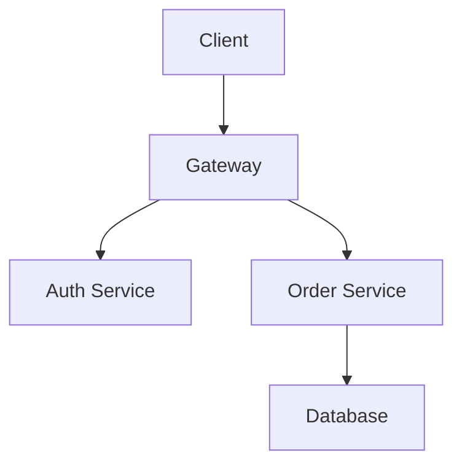
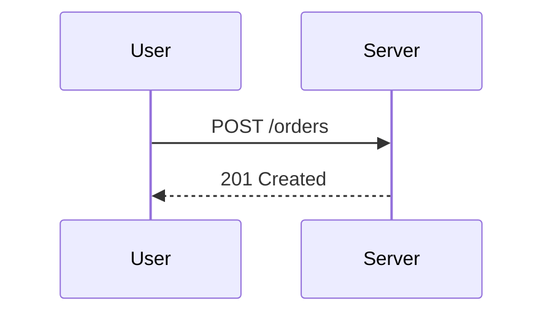

# Mermaid Diagrams

Mermaid fences are rendered as diagrams rather than highlighted as
source code, but at the Markdown level they are still fenced blocks
that happen to carry a well known info string.

The first fence describes a flow chart and the second a sequence
diagram. Both use the same info string, so a parser that maps the info
string to a diagram renderer should emit two diagrams for this file.

Diagrams are not code blocks in the usual sense, yet they still count
as fenced blocks when a test only looks at the fence structure. The
distinction matters when a document mixes prose with generated
pictures.

Diagram source is not executed by the Markdown engine. The engine only
records the info string and the body, then hands both to whatever
renderer the host provides.

That separation is useful in tests, because the fence count stays
stable even when no diagram library is installed. The body is just
text until a renderer claims it.

Two fences, two diagram kinds, one file.
